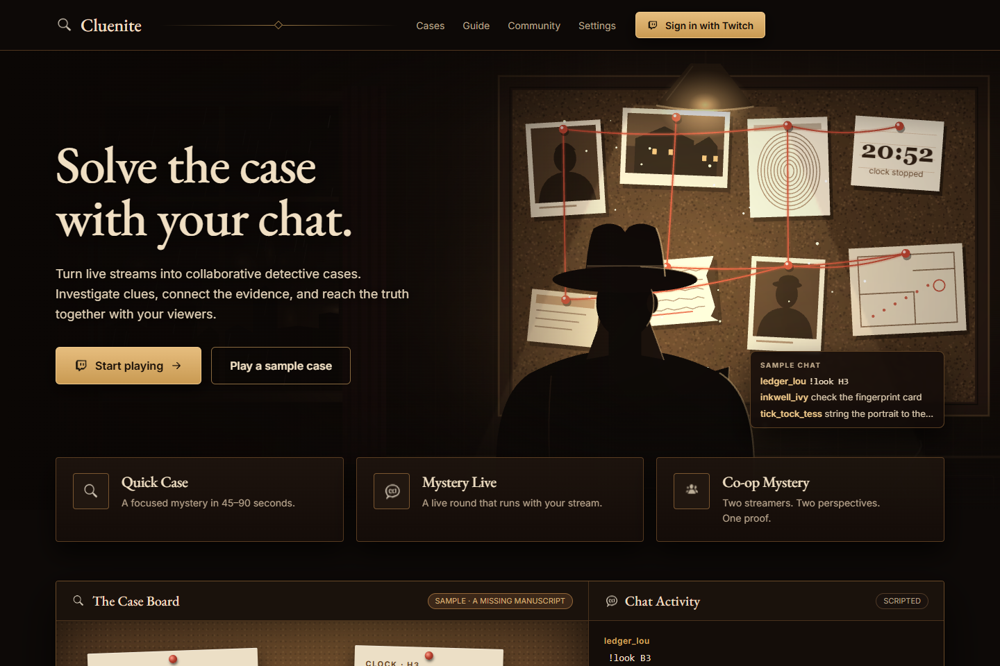
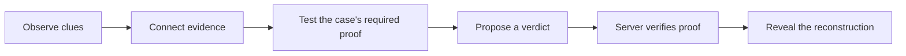
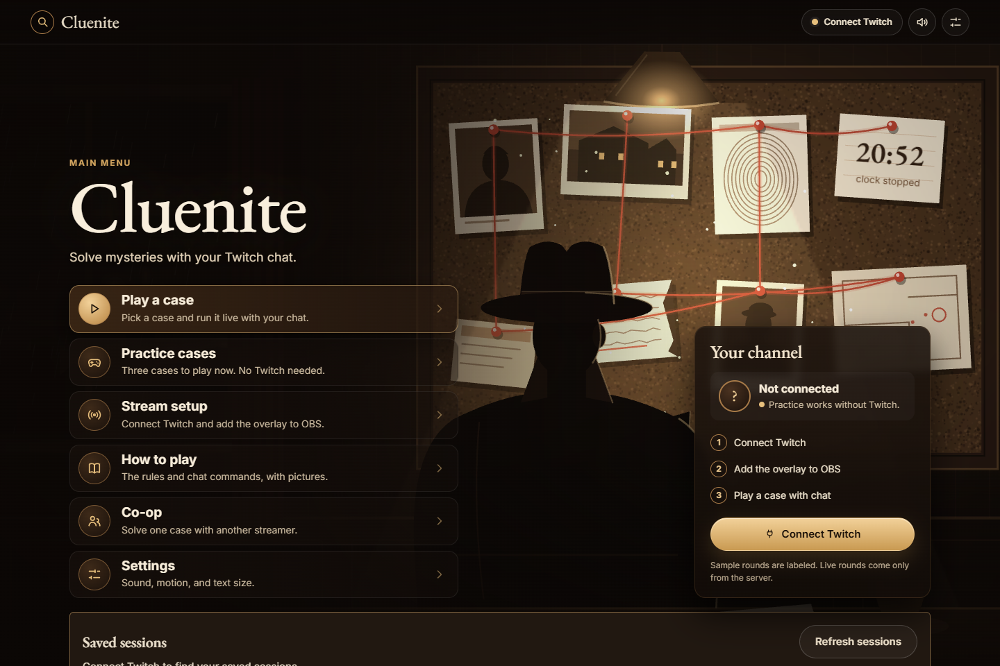
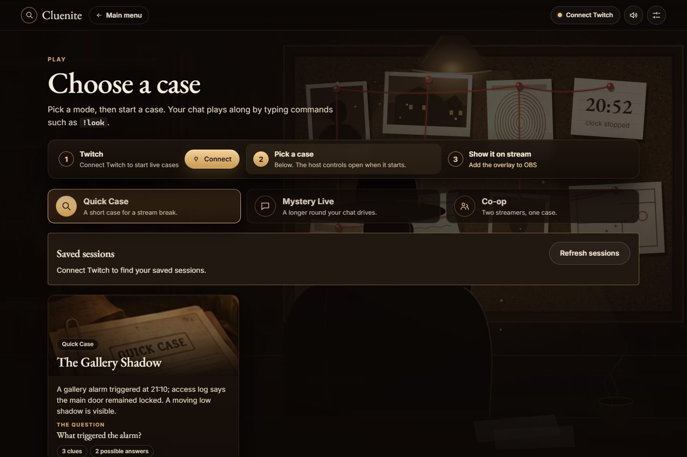
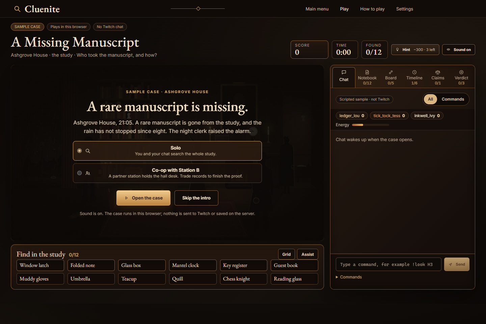
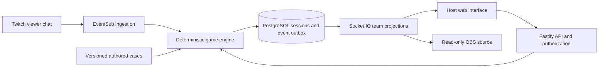

<h1 align="center">Cluenite</h1>
<p align="center"><strong>Your chat finds the clues. The evidence decides the ending.</strong></p>
<p align="center">A Twitch-native detective game for one stream or two cooperating communities.</p>
<p align="center">
  
  
  
  
</p>
<p align="center">
  <a href="#quick-start">Run locally</a> ·
  <a href="#three-ways-to-investigate">Gameplay</a> ·
  <a href="#inside-cluenite">Screenshots</a> ·
  <a href="docs/README.md">Documentation</a> ·
  <a href="docs/STATUS.md">Current status</a>
</p>

<a href="docs/assets/screenshots/landing.png"></a>

_Actual local application captures, 2 November 2026. The frontend is under active development. These images show anonymous pages and clearly identified local practice, not a deployed service or live Twitch audience. [Capture manifest](docs/assets/screenshots/manifest.json)._

> **Frontend and backend release · production Twitch acceptance pending.** Open [Cluenite on Render](https://cluenite-app.onrender.com). The immersive frontend connects saved sessions, host and partner controls, Twitch status, scoped OBS links and Q01/M01/C01 gameplay to the existing backend. See the [latest release record](docs/operations/FRONTEND_RELEASE_2026-11-03.md) for the exact tested source, CI and deployment evidence. [Current status](docs/STATUS.md) separates synthetic integration checks from real production Twitch acceptance.

## Why Cluenite?

Chat can do more than vote for an answer. In Cluenite, viewers inspect sources, discover records, test a theory and build enough proof to support a verdict. A lucky guess does not replace the investigation.

The streamer hosts the round. Viewers participate through ordinary Twitch chat. The backend validates commands and stores progress; the browser and OBS source render the authorized state.

| What a stream needs                                  | What Cluenite provides                                       |
| ---------------------------------------------------- | ------------------------------------------------------------ |
| A shared activity without another viewer application | Chat commands such as `!look`, `!link` and `!solve`          |
| A mystery with a reasoned ending                     | Authored evidence requirements and server-validated verdicts |
| Control over broadcast pacing                        | Start, pause, resume and stop from the host panel            |
| Progress that survives a page refresh                | PostgreSQL-backed sessions and explicit continuation         |
| A collaboration between two channels                 | Separate station discoveries and shared proof after consent  |
| A broadcast-safe presentation                        | Scoped, expiring and revocable read-only OBS links           |

## Three ways to investigate

| Mode              | Authored live case                 | Experience                                                                                                |
| ----------------- | ---------------------------------- | --------------------------------------------------------------------------------------------------------- |
| **Quick Case**    | Q01 — The Gallery Shadow           | A focused observation, evidence and verdict round.                                                        |
| **Mystery Live**  | M01 — The Missing Festival Trophy  | A longer investigation with event ordering, theories, challenges and hints.                               |
| **Co-op Mystery** | C01 — Signal of the Invisible Ship | Two consenting broadcasters investigate complementary stations; both communities contribute to the proof. |



The local manuscript, express and lighthouse **practice experiences use separate scripted content and browser state**. They introduce the interface without Twitch; their progress is separate from the persisted authored live cases. [Routes and integration boundaries](docs/agent-handoff/FRONTEND_BACKEND_INTEGRATION.md).

Open `/play#practice` to choose a practice case, `/practice/express` for Pearls on the Night Express, or `/practice/lighthouse` for The Lighthouse Went Dark. The co-op practice partner is scripted; authenticated C01 uses two real stations.

Practice and authored play share a viewport workspace with optional panels and animated evidence inspection. Manuscript's opening/search use the full screen, with Finds and chat opened on demand. `/preview/gallery`, `/preview/festival`, and `/preview/signal` preview public metadata; starting an authored case still uses Twitch and a hosted session.

## Inside Cluenite

Select an image to inspect it at full size. The current visual direction is **Cinematic Brown Noir**: warm brass, walnut, parchment and an investigation scene at the center of the screen.

<table>
<tr>
<td width="50%" valign="top">
<h3>A clear place to begin</h3>
<p>The main menu connects practice, live case selection, stream setup, co-op and accessibility settings.</p>
<a href="docs/assets/screenshots/main-menu.png"></a>
</td>
<td width="50%" valign="top">
<h3>Choose your investigation</h3>
<p>Browse the current practice experiences and authored live catalogue. Signed-in broadcasters can continue their saved sessions.</p>
<a href="docs/assets/screenshots/case-library.png"></a>
</td>
</tr>
</table>

<a href="docs/assets/screenshots/manuscript-practice.png"></a>

_A Missing Manuscript is a local scripted practice experience. Its scene and sample activity are not evidence of live viewer participation._

## Quick start

Use **Node.js 22.12+ within the Node 22 line** and the repository-pinned **pnpm 12.16.1**. The full backend needs a reachable PostgreSQL database; PostgreSQL 18 is the configured deployment target. Real Twitch login/chat additionally needs a Twitch Developer application and broadcaster consent.

```powershell
git clone https://github.com/AndroLay/cluenite.git
cd cluenite
npx --yes pnpm@12.16.1 install --frozen-lockfile
if (-not (Test-Path .env)) { Copy-Item .env.example .env }
```

The repository is private; cloning requires access. Set `DATABASE_URL`, the signing/encryption keys and `PUBLIC_ORIGIN` in the ignored `.env` file. Add Twitch credentials for live authorization. Preserve existing environment values. The [local setup guide](docs/development/local-setup.md) explains each step and the callback/origin requirements.

```powershell
npm run dev
```

Open **http://localhost:5173**. The API defaults to **http://localhost:10000**; `/health/ready` checks database readiness. The API applies migrations before listening. Both HTTP and Socket.IO share the same frontend proxy target.

1. Try a practice case from the main menu, or connect your Twitch channel for a live round.
2. Open **Play**, continue a saved session or create an authored case, then use **Start** in its host controls.
3. Open **Stream setup**, select the session and explicitly create/copy its private OBS link.
4. Add an OBS browser source using that link; keep the credential private.
5. For C01, create a lobby under **Co-op**, invite a partner by Twitch username and wait for their acceptance before starting.

For frontend-only practice development, `npm --prefix apps/web run dev` serves the local interface; backend account, session and live-case functions still require the API. [Complete startup and troubleshooting](docs/development/local-setup.md).

## Architecture



The server owns progress, proof, lifecycle and verdicts. Shared schemas validate transport data. Co-op projections restrict each participant to their authorized station; overlay credentials retain their own team scope even when the browser has another account's cookie.

| Directory                                                             | Responsibility                                                                                |
| --------------------------------------------------------------------- | --------------------------------------------------------------------------------------------- |
| [apps/web](apps/web/)                                                 | Vue/Vite site, local practice, live boards, host controls and OBS presentation.               |
| [apps/server](apps/server/)                                           | OAuth, EventSub, HTTP/Socket.IO, persistence and orchestration.                               |
| [packages/contracts](packages/contracts/)                             | Shared Zod schemas and transport types.                                                       |
| [packages/engine](packages/engine/)                                   | Deterministic game transitions, proof checks and safe snapshots.                              |
| [packages/cases](packages/cases/)                                     | Versioned Q01/M01/C01 content; private truth stays server-side.                               |
| [packages/ui](packages/ui/) · [packages/graphics](packages/graphics/) | Shared audio and browser animation utilities.                                                 |
| [tests](tests/)                                                       | Shared contract/engine checks and browser fixtures; server tests also live beside the server. |
| [docs](docs/) · [scripts](scripts/)                                   | Current guides, contracts, evidence, archives and maintenance tools.                          |

The current backend uses bounded HTTP/socket work, PostgreSQL timeouts, input limits and idle outbox backoff. These controls support graceful overload handling; they do not establish unlimited capacity. [Resource limits and measured scope](docs/operations/BACKEND_RESOURCE_LIMITS.md) · [Repository map](docs/repository-map.md).

## Verification and current limits

```powershell
npm run typecheck
npm run build
npm test
npm run docs:check
```

Database integration tests require the local `cluenite` development database. Browser fixtures reserve ports; read the [verification prerequisites](apps/server/README.md#verification) and [browser-test guide](tests/e2e/README.md) before running them alongside a shared local server.

| Evidence                                                                         | What it establishes                                                                                               | Boundary                                                                      |
| -------------------------------------------------------------------------------- | ----------------------------------------------------------------------------------------------------------------- | ----------------------------------------------------------------------------- |
| [Current frontend integration](docs/evidence/frontend-integration-2026-11-02.md) | Eight regressions, fourteen isolated browser scenarios and read-only checks with two already-authorized accounts. | Local working-tree evidence; synthetic provider/viewer inputs are identified. |
| [Backend release record](docs/operations/BACKEND_RELEASE_2026-11-02.md)          | Dated PostgreSQL, real Twitch/OBS, source publication and CI evidence.                                            | Applies to the exact versions and environments recorded there.                |
| [Resource verification](docs/operations/BACKEND_RESOURCE_LIMITS.md)              | Bounded work, overload rejection/recovery and local database limits.                                              | Controlled probes, not a production concurrency guarantee.                    |
| [Screenshot manifest](docs/assets/screenshots/manifest.json)                     | Actual local UI captures with route and practice boundaries.                                                      | Visual record, not a usability study or deployment proof.                     |

**Still in development:** frontend polish, broader player/accessibility acceptance, completed Twitch authorization/gameplay on the production origin, live rollback/cloud PITR rehearsal and authenticated capacity. A bounded smoke load and local restore of a production export pass. The backend runs on one always-on Singapore web service with private PostgreSQL 18; manual deployment keeps the uncommitted frontend separate. [Current status](docs/STATUS.md) · [Deployment evidence](docs/operations/BACKEND_RELEASE_2026-11-02.md#subsequent-backend-verification) · [Published CI](https://github.com/AndroLay/cluenite/actions).

## Documentation and contributing

- **Get started:** [Local setup](docs/development/local-setup.md) · [Development guide](docs/development/contributing.md).
- **Build together:** [Collaboration](docs/development/collaboration.md) · [Integration runbook](docs/operations/integration-runbook.md).
- **Implement against the contracts:** [API/realtime](docs/agent-handoff/BACKEND_CONTRACTS.md) · [Frontend/backend wiring](docs/agent-handoff/FRONTEND_BACKEND_INTEGRATION.md) · [Architecture decisions](docs/architecture/DECISIONS.md).
- **Review progress:** [Status](docs/STATUS.md) · [Evidence index](docs/evidence/README.md) · [Current handoffs](docs/README.md#current-handoffs).
- **Navigate the repository:** [Documentation home](docs/README.md) · [Repository map](docs/repository-map.md) · [Historical notes](docs/history/README.md).

Use English for authored documentation, interface copy, code comments and development material. Preserve user work, keep secrets out of the frontend and repository, and label practice/fixture data honestly. Font notices remain beside the [bundled fonts](apps/web/src/assets/fonts/); preserved visual references retain their [source context](docs/design/frontend-target/references/README.md).
