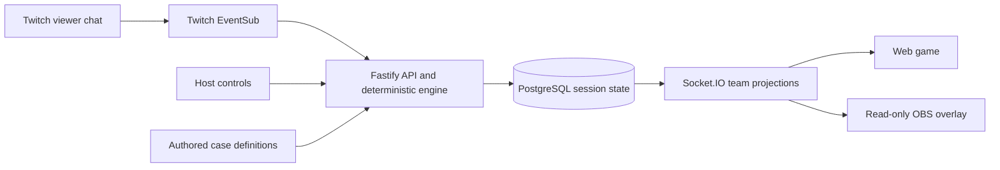

<h1 align="center">Cluenite</h1>
<p align="center"><strong>Your chat finds the clues. The evidence decides the ending.</strong></p>
<p align="center">A Twitch-native detective game for one stream or two cooperating communities.</p>
<p align="center">
  <a href="https://cluenite-app.onrender.com"><strong>Play Cluenite →</strong></a>
  · <a href="https://cluenite-app.onrender.com/play#practice">Try a practice case</a>
</p>
<p align="center">
  <a href="https://github.com/AndroLay/cluenite/actions/workflows/ci.yml"></a>
  <a href="LICENSE"></a>
  
  
  
</p>

<p align="center">
  
</p>
<p align="center"><sub>Anonymous local application capture. The sample chat is scripted; see the <a href="docs/assets/screenshots/manifest.json">capture manifest</a> for route and evidence boundaries.</sub></p>

Cluenite turns a Twitch stream into a collaborative detective story. Viewers inspect clues, connect admissible evidence and build enough proof to support a verdict. The server owns case progress and evaluates the proof, while the host controls the pace of the investigation.

## Investigate together

| Mode              | Live case                          | How it plays                                                                       |
| ----------------- | ---------------------------------- | ---------------------------------------------------------------------------------- |
| **Quick Case**    | Q01 · The Gallery Shadow           | A focused observation, evidence and verdict round.                                 |
| **Mystery Live**  | M01 · The Missing Festival Trophy  | A longer investigation with event ordering, theories, challenges and hints.        |
| **Co-op Mystery** | C01 · Signal of the Invisible Ship | Two consenting broadcasters investigate separate stations and combine their proof. |

Live cases use Twitch chat and require broadcaster authorization. The local practice cases are separate, clearly labeled experiences with scripted chat; they do not create live Twitch rounds or persisted case sessions.

<p align="center">
  
  
</p>

## How a round works



The server validates commands, evidence and verdicts. Shared schemas define the API and realtime messages. Co-op views are limited to each participant's authorized station; OBS links are scoped read-only credentials.

## Quick start

Use **Node.js 22.12+ (Node 22)**, **pnpm 12.16.1**, and a reachable **PostgreSQL 18** database. Real Twitch login and chat also require a Twitch Developer application and broadcaster authorization.

```powershell
git clone https://github.com/AndroLay/cluenite.git
cd cluenite
pnpm install --frozen-lockfile
Copy-Item .env.example .env
```

Configure the database URL, public origin and required signing/encryption keys in `.env`. Add Twitch OAuth credentials and the matching callback URL to exercise live cases. Keep real credentials out of source control.

```powershell
pnpm dev
```

Open **http://localhost:5173**. The API defaults to **http://localhost:10000**. Its `/health/ready` endpoint checks database readiness, and the server applies migrations before listening. The [setup guide](docs/setup.md) covers environment values and Twitch callback configuration.

## Source map

```text
apps/web/            Vue site, practice cases, live boards, host and OBS views
apps/server/         OAuth, Twitch EventSub, HTTP, Socket.IO and persistence
packages/contracts/  Shared request, response and realtime schemas
packages/engine/     Deterministic game transitions and proof checks
packages/cases/      Versioned Q01, M01 and C01 case definitions
tests/               Shared engine, contract and browser tests
```

## Project docs

- [Documentation index](docs/README.md) · [Setup](docs/setup.md) · [API](docs/api.md) · [Architecture](docs/architecture.md)
- [Deployment and Render](docs/deployment.md) · [Contributing](docs/contributing.md) · [Testing](docs/testing.md)
- [Hackathon judge guide and status](docs/hackathon.md) · [Asset attribution](docs/attribution.md) · [MIT License](LICENSE)
